# Detecção de presença humana sem câmera com Wi-Fi CSI e TinyML no ESP32

**Disciplina:** Inteligência Artificial Embarcada (mestrado) — projeto de ponta a ponta:
ideia → dados → modelo → treino → otimização → implantação em microcontrolador.

**Ideia.** Detectar se há uma pessoa num ambiente **sem câmera, microfone ou dispositivo
vestível**, usando apenas como o corpo humano altera o sinal Wi-Fi entre dois ESP32. O sinal não
forma imagem nem identifica quem está presente, o que preserva a privacidade. Ao contrário de um
sensor de movimento PIR, ele também enxerga pessoas **paradas** e atravessa obstáculos leves
(porta, parede). Isso o torna promissor para ambientes grandes ou obstruídos, onde seriam
necessários muitos sensores comuns.

**Saída.** Um ESP32-C3 transmite pacotes a 40 Hz. Um ESP32-WROOM mede o *Channel State
Information* (CSI) de cada pacote, roda **duas redes neurais INT8 embarcadas** (TensorFlow Lite
Micro) e indica o estado num LED:

| estado | significado | LED (GPIO25) |
|---|---|---|
| `EMPTY` | ninguém perto do enlace TX–RX | apagado |
| `STATIC` | pessoa presente e parada | pisca (500 ms / 500 ms) |
| `MOVING` | pessoa se movendo | aceso |

O objetivo principal é **presença** (vazio × ocupado). `STATIC` e `MOVING` são subcategorias
de "ocupado": confundir uma com a outra é aceitável; confundir qualquer uma delas com `EMPTY` não é.

---

## Requisitos: ferramentas, dependências e papel de cada uma

### Hardware

| item | papel | por que este |
|---|---|---|
| ESP32-C3 (`esp32-c3-devkitm-1`) | **TX**: transmite pacotes ESP-NOW em broadcast a 40 Hz | barato; qualquer ESP32 serve como transmissor |
| ESP32-WROOM (`esp32dev`) | **RX**: mede o CSI, roda os 2 modelos, aciona o LED | CSI nativo na API Wi-Fi, 520 KB de SRAM, FPU, suporte oficial a TFLite Micro |
| LED + resistor 330 Ω | indicação dos 3 estados | saída visível sem serial |
| jumper GPIO26–3V3 | pedir calibração da sala vazia no boot | operação sem PC |


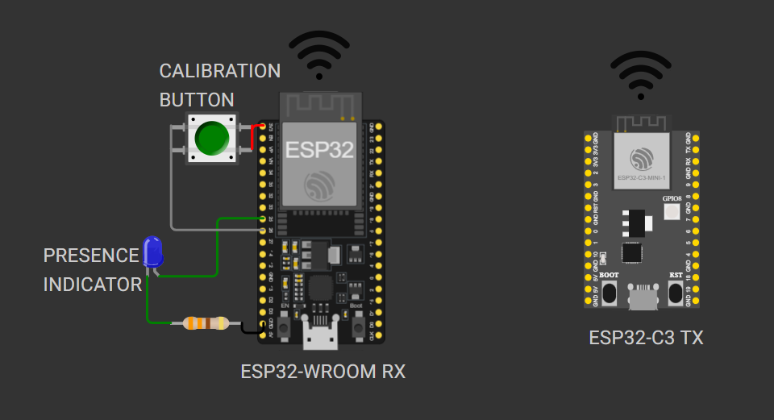

### Software do firmware (ESP32)

| ferramenta / versão | papel no projeto | justificativa |
|---|---|---|
| **PlatformIO** (`espressif32@6.13.0`) [12] | compila, grava e monitora TX e RX (`platformio.ini`) | um comando por placa e ambientes separados para cada modo de firmware |
| **ESP-IDF 5.5.3** [3] | framework oficial da Espressif: Wi-Fi, ESP-NOW, **API de CSI**, FreeRTOS, NVS | só o ESP-IDF expõe o CSI por pacote (`esp_wifi_set_csi_rx_cb`) |
| **esp-tflite-micro 1.4.1** [4] | runtime **TensorFlow Lite Micro** [5] que executa os `.tflite` INT8 | interpretador oficial para microcontroladores, sem heap nem sistema operacional |
| esp-nn 1.5.0 | kernels int8 da Espressif usados pelo TFLM (assembly no ESP32-S3; versões em C no ESP32) | vem como dependência do esp-tflite-micro |
| esp_csi_gain_ctrl 0.1.5 | controle de ganho do exemplo ESP-CSI [2] | herdado do exemplo da Espressif; não é usado na versão atual |
| `dependencies.lock` | fixa as versões exatas acima | reprodutibilidade da compilação |

### Software de treino e análise (PC)

| pacote | papel no projeto | justificativa |
|---|---|---|
| Python 3.10–3.13 | linguagem de todo o pipeline (`ml/`) | — |
| **PyTorch** [10] | define e **treina** as duas MLPs | controle total do laço de treino (pesos por sessão, sementes, determinismo) |
| **TensorFlow / TFLite Converter** [7] | converte as MLPs para **TFLite INT8** e executa o `.tflite` no PC | é o formato que o TFLite Micro executa; o conversor faz a quantização inteira |
| scikit-learn [11] | regressão logística de referência | baseline linear para comparar com a MLP |
| NumPy / pandas | leitura dos logs, features, métricas | — |
| matplotlib | todas as figuras deste README | — |
| pyserial | `tools/capture_serial.py` (gravar datasets) | só na coleta |
| g++ ou clang++ (opcional) | testes nativos C++ × Python (`tests_native/`) | compila os mesmos headers do firmware no PC |

Instalação: `pip install -r ml/requirements.txt` (versões testadas no próprio arquivo).

---

## Resumo dos resultados

| fase | avaliação | resultado |
|---|---|---|
| treino / validação | movimento — validação deixando **um setup inteiro** fora (5 setups) | acurácia balanceada 0,997 – 1,000 |
| validação ao vivo | movimento — 3 logs gravados no ESP32, nunca usados no treino | caminhada: 94 – 100 % das janelas; pessoa parada vista como movimento: 0 % |
| treino / validação | presença — validação deixando **uma sessão inteira** fora (6 sessões) | acurácia balanceada média 0,861 (pior sessão 0,789) |
| validação | presença por episódio (cada fase conta uma vez) | 19 de 21 fases com pessoa detectadas; 23 de 27 fases vazias corretas |
| sistema completo | 3 estados, janelas de pessoa parada classificadas como ocupado | 90 % (vazio corretamente vazio: 84 %) |
| otimização | 2 MLPs de 273 parâmetros, quantização INT8 completa | 3,4 KB cada; decisão igual ao float em ≥ 99,6 % das janelas |
| implantação | inferência medida no ESP32 (240 MHz) | 0,42 ms por modelo, 1 decisão a cada 480 ms |
| implantação | TFLite (PC) × TFLite Micro (ESP32), 2197 janelas | 2196 saídas int8 idênticas (máx. 1 LSB) |

---

## Sumário (fases de desenvolvimento)

1. [Definição dos objetivos](#1-definição-dos-objetivos) — inclui a fundamentação do CSI
2. [Coleta de dados](#2-coleta-de-dados) — firmwares de captura e datasets
3. [Pré-processamento](#3-pré-processamento)
4. [Definição do modelo](#4-definição-do-modelo)
5. [Treinamento](#5-treinamento) — como foi treinado, resultados e como interpretá-los
6. [Otimização do modelo](#6-otimização-do-modelo) — quantização INT8, memória, latência
7. [Refinamento](#7-refinamento) — iterações e comparação de variantes
8. [Implantação na plataforma](#8-implantação-na-plataforma) — PyTorch → TFLite → TFLite Micro
9. [Análise dos resultados](#9-análise-dos-resultados) — validação e discussão
10. [Relatório e reprodução](#10-relatório-e-reprodução)

[Referências](#referências)

---

## 1. Definição dos objetivos

### 1.1 Problema e motivação

Sensores de presença comuns (PIR) detectam variação de calor em **movimento** e precisam de
linha de visada: uma pessoa parada lendo ou dormindo "desaparece", e cada obstáculo cria uma zona
cega. Câmeras resolvem isso, mas comprometem a privacidade. O Wi-Fi já está presente em quase todo
ambiente, atravessa paredes leves e é afetado por **qualquer** corpo no caminho do sinal, parado ou
não. A pergunta do projeto é: **um microcontrolador de baixo custo consegue, com um modelo de ML
embarcado, transformar essa perturbação do sinal numa decisão confiável de presença?**

### 1.2 Objetivos e critérios de sucesso

| # | objetivo | como é medido |
|---|---|---|
| O1 | detectar **presença** (vazio × ocupado), inclusive pessoa parada | recall de presença, especificidade e acurácia balanceada em sessões **não vistas no treino** |
| O2 | distinguir **parado × em movimento** (secundário) | taxa de MOVING em caminhada e em pessoa parada |
| O3 | inferência **100 % embarcada**, sem PC nem nuvem | modelo INT8 no ESP32; latência e memória medidas |
| O4 | resultado **igual** no PC e na placa | paridade C++ × Python e TFLite × TFLite Micro |
| O5 | pipeline **reproduzível** | `python ml/run_all.py` regenera modelos, métricas e figuras |

### 1.3 Fundamentação: o que é CSI e como ele "vê" pessoas

**OFDM e subportadoras.** O Wi-Fi 802.11 (a/g/n) usa OFDM: o canal de 20 MHz é dividido em 64
subportadoras espaçadas de 312,5 kHz, cada uma transmitindo um símbolo independente. No início de
cada pacote há campos de treinamento com símbolos **conhecidos** pelo receptor — o *Legacy Long
Training Field* (LLTF) e, em pacotes 802.11n, o *HT-LTF* [8].

**Estimativa do canal.** Como o receptor sabe o que foi enviado (`X_k`) e mede o que chegou
(`Y_k`), ele estima a resposta em frequência do canal em cada subportadora `k`:

```
Y_k = H_k · X_k + ruído        →        Ĥ_k = Y_k / X_k        (número complexo: amplitude e fase)
```

O vetor `{Ĥ_k}` é o **CSI**. O RSSI é um único número (potência total); o CSI descreve o canal
subportadora por subportadora [9]. A ferramenta de Halperin et al. [9] popularizou a leitura do CSI
em placas Wi-Fi comerciais, base de boa parte da literatura de *Wi-Fi sensing* [8]; no ESP32 ele
vem da API do ESP-IDF [3].

**Por que uma pessoa altera o CSI.** Em ambiente interno o sinal chega por vários caminhos:
direto, refletido em paredes, móveis e pessoas. Cada caminho `i` tem atenuação `a_i` e atraso
`τ_i`, e o canal é a soma `H(f) = Σ_i a_i · e^(−j2πfτ_i)`. Como o atraso vira fase diferente para
cada frequência, os caminhos se somam construtiva ou destrutivamente de forma diferente em cada
subportadora. O resultado é um **padrão de amplitudes ao longo das 51 subportadoras** — uma
"assinatura" do ambiente. Um corpo humano (≈ 60 % água) absorve, reflete e difrata o sinal em
2,4 GHz (λ ≈ 12 cm), o que gera dois efeitos [8]:

* **pessoa parada** → acrescenta/bloqueia caminhos e muda a **forma** da assinatura de modo
  estável (é o que o estágio de presença mede);
* **pessoa se movendo** → os atrasos variam continuamente e a assinatura **flutua no tempo** entre
  pacotes consecutivos (é o que o estágio de movimento mede).

**Como o ESP32 entrega o CSI.** Com `esp_wifi_set_csi_rx_cb` e modo promíscuo, cada pacote
recebido gera um `wifi_csi_info_t` com metadados (`rssi`, `timestamp`, `sig_mode`, `cwb`, `stbc`,
canal secundário…) e um buffer de `int8` intercalando parte imaginária e real de cada subportadora.
Para um pacote HT de 20 MHz sem canal secundário e sem STBC, o buffer tem **256 bytes**: 64
subportadoras do LLTF seguidas de 64 do HT-LTF, na ordem `0…31, −32…−1` [3].

**Escolhas sobre o CSI bruto:**

| escolha | motivo |
|---|---|
| usar só o **LLTF** | existe em todo pacote; em 802.11a/g, 52 subportadoras úteis (−26…−1, +1…+26) |
| descartar a subportadora +1 → **51** | no ESP32 os 4 primeiros bytes podem ser inválidos (`first_word_invalid`, limitação de hardware documentada [3]); a mesma máscara de 51 subportadoras é usada em [1] |
| usar só a **amplitude** `|Ĥ_k|` | a fase do ESP32 tem desvios aleatórios por pacote (frequência e relógio do oscilador), que exigiriam saneamento; a amplitude é estável |
| dividir pela **mediana** do pacote | com `manu_scale = false` o ESP32 escala o CSI automaticamente por pacote [3]; a razão entre subportadoras é preservada, a escala absoluta não. Normalização adotada de [1] |

### 1.4 Banda, canal, largura e taxa: o que mudam e o que foi usado

| parâmetro | efeito sobre o CSI | escolha | justificativa |
|---|---|---|---|
| **banda** | 2,4 GHz atravessa paredes melhor que 5 GHz (menor atenuação), mas é mais congestionada | 2,4 GHz | única banda do ESP32-WROOM e do ESP32-C3; a penetração favorece detectar pessoas atrás de obstáculos |
| **canal** | outras redes e Bluetooth no mesmo canal disputam o ar, causando perda de pacotes e ruído no CSI; na largura de 20 MHz só 1, 6 e 11 não se sobrepõem | **11** (2462 MHz) | é o `CONFIG_LESS_INTERFERENCE_CHANNEL` dos exemplos `csi_send`/`csi_recv` da Espressif [2]. Em outro local, verifique a ocupação (*Wi-Fi analyzer*) e troque nos dois firmwares |
| **largura** | HT40 ocupa 2 canais e acrescenta um HT-LTF de 114 subportadoras, mas o **LLTF continua com 52 úteis**; o layout do buffer muda com o canal secundário | **HT20** | o projeto usa só o LLTF, então HT40 não acrescentaria informação, só ocuparia o dobro do espectro e exporia o enlace a mais interferência. O exemplo da Espressif [2] usa HT40; o projeto mudou para HT20 para ter o mesmo formato do dataset público de [1] (20 MHz, HT, 256 bytes) e manteve |
| **taxa / modulação** | se a taxa varia, o formato do pacote varia | **MCS0, GI longo, fixa** (`esp_now_set_peer_rate_config`) | modulação mais robusta, todo pacote tem o mesmo formato (HT, 256 bytes); o RX descarta qualquer outro formato |
| **frequência de pacotes** | define a resolução temporal; andar a ~1 m/s gera flutuações de até ~16 Hz no caminho refletido (Doppler em 2,4 GHz) | **40 Hz**, reamostrado a 25 Hz | o exemplo [2] usa 100 Hz; as primeiras capturas a 100 Hz perdiam pacotes na serial. Para *detectar* movimento basta perceber que a assinatura varia entre quadros, e não medir a velocidade; 40 Hz faz isso e ocupa menos o canal |
| **topologia** | CSI pode vir de roteador, de outro ESP32 conectado ou de um transmissor dedicado | **TX dedicado em broadcast ESP-NOW** | é o método que a Espressif indica como de maior precisão e confiabilidade, sem depender de roteador [2] |
| **antenas / distância** | antena de PCB é direcional; enlace curto demais satura | placas fixas, ≥ 1 m entre elas | recomendações do ESP-CSI [2] (antena externa IPEX é melhor; distância > 1 m) |

Configuração no código: `src/tx/app_main.c` e `src/rx/app_main.c` (canal, HT20, MCS0, sem economia
de energia) e `sdkconfig.*.defaults` (CSI habilitado, AMPDU desligado como no exemplo, 128 buffers
de RX, console a 921600 baud).

### 1.5 Projeto de referência: o que foi usado e o que foi só inspiração

O projeto de Fahim et al. (BUET) [1] detecta presença e movimento com CSI em três ESP32-S3 e
publica dados, código e resultados. Ele entrou neste trabalho de duas formas.

**Usado diretamente:**

| o que | onde aparece aqui | por quê |
|---|---|---|
| **dataset público** (39 sessões, ESP32-S3, canal 6, 20 MHz) | só na fase exploratória (12/11): primeira MLP PyTorch e primeiro `.tflite` | permitiu montar o pipeline de treino e conversão antes de existirem dados próprios; ao vivo no nosso hardware o modelo falhou (*domain shift*, seção 7.1) e o dataset **não faz parte** dos dados finais |
| **parâmetros da cadeia de pré-processamento**: máscara de 51 subportadoras LLTF, normalização pela mediana do pacote, reamostragem linear a **25 Hz** com rejeição de lacunas > **0,25 s**, janelas de **2 s (50 amostras)** a cada **0,48 s**, aceitar só pacotes HT de 20 MHz com 256 bytes | firmware (`csi_live.cpp`) e todo o pipeline Python | o modelo exploratório precisava receber entradas idênticas às do dataset público; os parâmetros foram mantidos porque funcionaram nos nossos dados (seções 5 e 9) e cabem na memória do ESP32 (janela de 50 × 51) |

**Insights citados** (recomendados ou testados em [1], não reimplementados a partir do código deles):

* separar o problema em **cascata presença → movimento**;
* medir a **referência da sala vazia ao ligar** (12 s de calibração em [1]);
* estabilizar a decisão olhando as **últimas 5 janelas** (votação por maioria em [1]; aqui, média com histerese);
* para presença, usar o **desvio em relação à referência vazia** (diferença absoluta, RMSE e correlação de perfil);
* comparar o modelo com um **limiar de uma única feature** e com **regressão logística**;
* separar o callback de CSI da impressão serial por uma **fila FreeRTOS**.

**Não foram usados:** o firmware deles (UDP sobre *soft-AP*, dois receptores), as 31/44 features, as
*random forests* e o painel web. Nenhum código nem dado de [1] é redistribuído neste repositório
(o projeto deles não tem licença aberta); para refazer a etapa exploratória, o dataset deve ser
obtido no repositório original. As 12 features temporais, a normalização pelo ruído da calibração,
as MLPs, o firmware de 3 estados e a validação por sessão são deste projeto.

---

## 2. Coleta de dados

### 2.1 Montagem

```text
ESP32-C3 (TX) ~~~~~~~~ rádio, canal 11 ~~~~~~~~ ESP32-WROOM (RX)
                                                 GPIO25 ── 330 Ω ── LED (+)   LED (−) ── GND
                                                 GPIO26 ── jumper ── 3V3   (fechado no boot = calibrar)
```

GPIO25/26 são os pinos *IO25/IO26* da placa, não o pino físico 25 do módulo. TX e RX ficam
**fixos** durante toda a captura e o uso. A referência de sala vazia descreve aquela geometria.

### 2.2 Firmwares usados em cada processo

O projeto teve firmwares diferentes para cada finalidade, e cada dataset foi gravado com um
deles. Na versão atual eles viraram **três modos do mesmo código** (`src/rx/firmware_config.h`),
selecionados pelo ambiente do PlatformIO:

| processo | comando | o que muda | linhas na serial | origem histórica |
|---|---|---|---|---|
| **captura de dataset** | `pio run -e rx_capture -t upload` | `-DCSI_FIRMWARE_MODE=1` | `CSI_SIG` (assinatura) e `CSI_F12` (12 features) em **toda janela**; funciona **sem calibração** | etapa 0017C (`CSI_SIG`) e firmware `FEATURES` de 12/11 |
| **teste e validação** | `pio run -e rx_validation -t upload` | `-DCSI_FIRMWARE_MODE=2` | tudo do modo captura + `CSI_STATE` e `CSI_VEC` (entradas/saídas int8 dos 2 modelos) em toda janela, `CSI_REF` no boot | etapas 0006–0010 (`CSI_PARITY`) |
| **demonstração / uso** | `pio run -e rx -t upload` | modo 0 (padrão) | só `CSI_STATE` nas transições e a cada ~4,8 s; LED | etapas 0012–0015 (LED, NVS) |
| transmissor (igual para todos) | `pio run -e tx -t upload` | — | — | exemplo `csi_send` da Espressif [2] |

Sem PlatformIO, o mesmo efeito se obtém editando o valor padrão de `CSI_FIRMWARE_MODE` em
`src/rx/firmware_config.h`. A primeira versão do projeto gravava o CSI bruto (`CSI_DATA`, um pacote
por linha, HT40 a 100 Hz); essas capturas foram descartadas por formato incompatível e perda de
pacotes.

### 2.3 Protocolo de captura

1. Firmware `rx_capture` no RX, TX ligado, sala vazia.
2. `python tools/capture_serial.py --port COM6 --out data/dataset/presence/G.log` (próxima letra livre). A cada mudança
   de fase digite o nome (EMPTY, P1, WALK…) + Enter; a marca usa o relógio do ESP32, o mesmo dos rótulos.
3. Sequência usada nas sessões: ≥ 20 s de espera + vazio inicial (calibração), fases de 30–60 s
   alternando **pessoa parada** em posições diferentes (dentro do quarto, na porta, atrás da parede,
   duas pessoas) e **sala vazia**, uma **caminhada**, e vazio no fim.
4. Registrar as fases em `data/manifest.json`.

### 2.4 Datasets e testes

Tudo está em [`data/`](data/) — logs seriais **brutos** do RX, sem edição; os rótulos ficam em
[`data/manifest.json`](data/manifest.json). Detalhes em [`data/README.md`](data/README.md).

| pasta | papel | conteúdo | firmware que gravou |
|---|---|---|---|
| `dataset/presence/` | **dataset** de presença: treino + validação cruzada | 6 sessões (`A.log` … `F.log`), 48 min, 5984 janelas, 21 fases com pessoa e 27 vazias | captura de assinatura (`CSI_SIG`) |
| `dataset/motion/` | **dataset** de movimento: treino + validação cruzada | 5 setups (`M1` … `M5`) × {`empty`, `static`, `moving`}, 1524 janelas de 12 features | captura de features (`FEATURES`) |
| `tests/motion_live/` | **teste** ao vivo do movimento (nunca entra no treino) | 3 logs (`live_A` … `live_C`), 2197 janelas: features, referência e entrada/saída int8 calculadas **na placa** | validação (`CSI_PARITY`) |

**Teste × dataset.** As capturas A, B e C nasceram como *testes* da etapa 0017 ("a assinatura
espectral separa pessoa parada de sala vazia?"). Como têm protocolo e horários registrados,
passaram a ser **dados de treino** — junto com D, E e F formam o dataset de presença, e a
avaliação é feita por validação cruzada deixando uma sessão inteira de fora. Os logs de
`tests/motion_live` continuam como **teste**: servem para medir o modelo de movimento no domínio
real da placa, com a referência que a própria placa calculou. Usá-los no treino eliminaria essa
verificação independente.

**Nomes.** Sessões de presença: letras `A`–`F` em ordem cronológica. Setups de movimento: `M1`–`M5`
(M1 referência, M2 RX reiniciado, M3 TX reiniciado, M4 nova sessão, M5 geometria alterada). Testes ao
vivo: `live_A`–`live_C`. Fases: `E0, E1…` (vazio), `P1, P2…` (pessoa parada em posições
diferentes), `P1+P2` (duas pessoas), `WALK`, `ARMS` (só braços). O `manifest.json` guarda o nome
original de cada arquivo (`original_file`).

**Capturas descartadas:** `teste_E.log` de 22/11 (o trecho vazio final ficou sem rótulo
confiável), `csi_signature_D.txt` de 19/11 (sem horários de fase), `changed_obstructed` (sem
protocolo registrado) e o CSV bruto inicial (HT40/100 Hz).

**Rótulos.** Os horários vêm do protocolo (cronômetro humano alinhado ao boot do RX). Para
absorver a imprecisão, as métricas descartam os 7 primeiros e os 5 últimos segundos de cada fase
(5 s de incerteza + 2 s de memória da janela). Trechos `UNKNOWN` (possível segunda pessoa no
cômodo vizinho; gato junto com a pessoa) nunca entram em treino nem em métrica.

---

## 3. Pré-processamento

### 3.1 Por pacote (no ESP32, `src/rx/csi_live.cpp`)

Os parâmetros desta cadeia (máscara, normalização, 25 Hz, 0,25 s, janela de 2 s a cada 0,48 s) vêm
de [1] (ver 1.5).

1. **Filtro de formato**: aceita só HT20, 256 bytes, sem STBC, sem canal secundário.
2. **Amplitude** das 51 subportadoras LLTF: `|H| = hypot(imag, real)` (índices 2–26 e 38–63).
3. **Normalização**: divide pela mediana das 51 amplitudes (remove o ganho automático).
4. **Reamostragem** por interpolação linear numa grade uniforme de **25 Hz**. O ESP-NOW não chega
   em intervalos exatos; lacunas > 250 ms reiniciam a janela e os filtros.

### 3.2 Por janela (50 amostras = 2 s, nova janela a cada 12 amostras = 480 ms)

**Para o movimento** — 12 features de variação temporal (`csi_features.cpp`): desvio-padrão de
cada subportadora no tempo, variação quadro-a-quadro `|w[t]−w[t−1]|`, mudança de forma
(1 − correlação entre quadros consecutivos) e espalhamento, resumidos por média, mediana e
percentil 90. Usam-se 7 delas (**Core7**: `carrier_change_mean/median/p90`, `frame_change_std/p90`,
`shape_change_mean/p90`), em **log-razão** contra a referência de sala vazia:
`x = log(max(f, 10⁻⁹) / max(ref, 10⁻⁹))`.

**Para a presença** — a **assinatura** `s[51]` é a média temporal de cada subportadora na
janela, quantizada em Q12 (exatamente o que aparece nas linhas `CSI_SIG`). O perfil de forma
`p = s / mean(s)` elimina o ganho global. Comparado com a referência `ref` (mediana de `p` na
calibração) e com o perfil de 5 janelas atrás `p₋₅` (~2,4 s), ele gera 7 features. As três
primeiras famílias (diferença absoluta, RMS e correlação de perfil em relação à referência vazia)
são as que [1] usou para presença:

| # | feature | definição | o que captura |
|---|---|---|---|
| 1 | `shape_rms` | `sqrt(mean((p−ref)²))` | desvio global da forma |
| 2 | `shape_mae` | `mean(|p−ref|)` | idem, robusto a picos |
| 3 | `shape_p90` | percentil 90 de `|p−ref|` | desvios em poucas subportadoras |
| 4 | `shape_max` | `max(|p−ref|)` | pior subportadora |
| 5 | `corr_loss` | `1 − Pearson(p, ref)` | mudança de formato independente de escala |
| 6 | `rssi_shift` | `|rssi − rssi_ref|` | atenuação/bloqueio do enlace |
| 7 | `temporal_delta` | `sqrt(mean((p−p₋₅)²))` | instabilidade recente (micro-movimentos) |

**Normalização pelo ruído da calibração**: `x = log(clip(F / scale, 0,01, 10⁴))`, com `scale` =
mediana de cada feature nas 20 janelas da calibração (com piso). Com isso, uma sala "ruidosa" e uma
"silenciosa" produzem `x ≈ 0` quando vazias. A escolha está justificada na [fase 7](#7-refinamento).

### 3.3 Calibração (o que o jumper faz)

Medir a referência da sala vazia ao ligar segue [1]. Com a área vazia, o ESP32 coleta 20 janelas (~10 s) e grava na NVS: a referência Core7 (7
medianas), o perfil `ref[51]`, `rssi_ref` e `scale[7]`. As duas referências vêm **do mesmo
intervalo**, e as janelas de calibração nunca entram em treino nem em métrica.

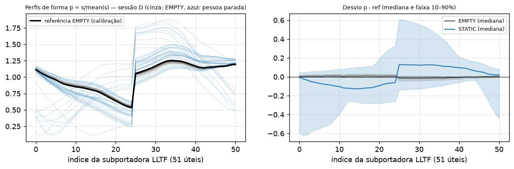

*Figura 1 — Sessão D. Esquerda: perfis de forma de janelas vazias (cinza) colam na referência
(preto); com uma pessoa parada (azul) o perfil se deforma, de modo diferente conforme a posição.
Direita: desvio `p − ref` (mediana e faixa 10–90 %). É esta deformação que o modelo de presença aprende.*

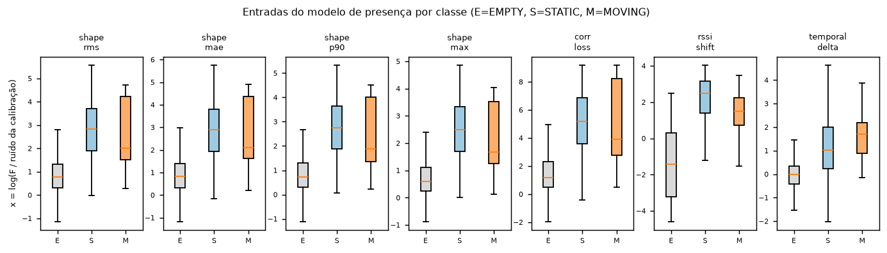

*Figura 2 — Entradas do modelo de presença por classe (6 sessões). Todas separam vazio de
ocupado; nenhuma separa bem parado de andando, e esse não é o papel deste estágio.*

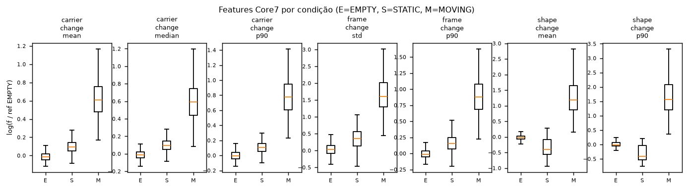

*Figura 3 — Entradas Core7 por condição. Movimento se destaca; vazio e parado se sobrepõem. Por
isso o movimento sozinho não detecta presença e foi preciso o estágio espectral.*

---

## 4. Definição do modelo

### 4.1 Arquitetura do sistema: dois estágios

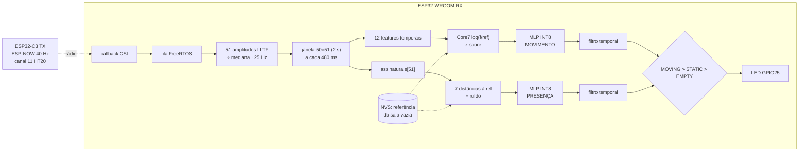

A primeira tentativa foi um classificador único de 3 classes sobre as features temporais. Na
validação ele reconheceu só 78 % das janelas de pessoa parada, e ao vivo, na geometria B, **0 de
55**: uma pessoa parada quase não gera variação temporal. A presença passou então a ser decidida
sobre a **forma do espectro médio**, num estágio próprio, e o movimento num segundo estágio,
seguindo a cascata presença → movimento testada em [1].

### 4.2 As redes

| | presença | movimento |
|---|---|---|
| entrada | 7 features espectrais normalizadas (z-score) | 7 features Core7 (z-score) |
| arquitetura | `7 → Dense 16 + ReLU → Dense 8 + ReLU → Dense 1 + sigmoide` | idem |
| parâmetros | 273 | 273 |
| saída | P(ocupado) | P(movimento) |
| operadores TFLite | `FULLY_CONNECTED`, `LOGISTIC` | idem |

**Por que uma MLP pequena:** as entradas já são features físicas compactas, então a rede só
precisa de uma fronteira não linear em 7 dimensões. 273 parâmetros cabem com folga no ESP32,
usam apenas 2 operadores do TFLite Micro e rodam em ~0,4 ms. Redes convolucionais/recorrentes
sobre o CSI bruto exigiriam muito mais dados do que as ~5 mil janelas disponíveis.

**Referências de comparação** (mesmo protocolo, como em [1]): *limiar 3×* (não supervisionado: ocupado se
`shape_rms > 3 ×` o ruído da calibração) e *regressão logística* (linear, scikit-learn [11], C = 0,1).

### 4.3 Pós-processamento temporal e fusão

Cada probabilidade passa por um **filtro** sobre as últimas 5 janelas, como em [1] (lá, votação por
maioria; aqui, média de ~2,4 s com histerese) —
entra no estado ativo com média ≥ 0,65, sai com ≤ 0,35. A fusão é `MOVING` se o filtro de
movimento está ativo; senão `STATIC` se o de presença está ativo; senão `EMPTY`. Movimento implica
presença.

---

## 5. Treinamento

### 5.1 Como foi treinado

| item | presença | movimento |
|---|---|---|
| dados | 6 sessões, 4156 janelas rotuladas (vazio × ocupado) | 5 setups, 1524 janelas (andando × vazio+parado) |
| pesos amostrais | cada sessão com o mesmo peso total; as duas classes com o mesmo peso total | cada setup×condição com o mesmo peso; classes balanceadas |
| padronização | z-score com média/desvio ponderados **do treino** de cada dobra | idem |
| perda | entropia cruzada binária ponderada (`BCEWithLogits`) | idem |
| otimizador | Adam, lr 0,003, weight decay 10⁻³, batch completo | Adam, lr 0,002, weight decay 10⁻³, batch completo |
| épocas | **300, fixas** | **160, fixas** (receita original do projeto) |
| reprodutibilidade | semente 42, 1 thread, algoritmos determinísticos do PyTorch [10] | idem |

**Sem early stopping e sem busca de hiperparâmetros nos dados de teste.** Escolher a época pela
curva de validação exigiria uma validação aninhada para continuar honesta. As curvas de validação
abaixo são **apenas observadas**.

**Protocolo de validação.** Janelas consecutivas se sobrepõem (2 s a cada 480 ms) e são quase
iguais entre si; sortear janelas para treino e teste mediria memorização. A unidade de validação é
portanto a **gravação inteira**:

* presença: *leave-one-session-out* (6 dobras; cada sessão é prevista por um modelo treinado nas outras 5);
* movimento: *leave-one-setup-out* (5 dobras, M1–M5) e *leave-one-campaign-out* (robustness = M1–M3 × independent = M4–M5).

### 5.2 Curvas de treino

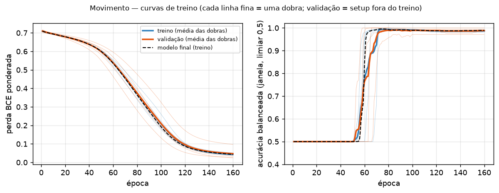

*Figura 4 — Movimento. Linhas finas: cada dobra; grossas: média; tracejado: modelo final.*

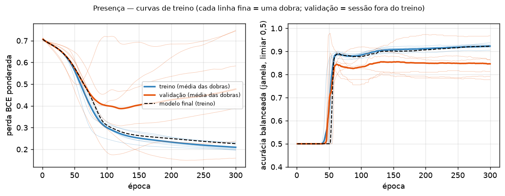

*Figura 5 — Presença. "Validação" = a sessão deixada de fora em cada dobra.*

### 5.3 Resultados do treino

| | movimento | presença (MLP) | presença (logística) |
|---|---|---|---|
| perda de treino (início → fim) | 0,709 → 0,044 | 0,706 → 0,226 | — |
| acurácia balanceada **no próprio treino** (estado estável) | 0,999 | 0,919 | 0,887 |
| acurácia balanceada **na validação cruzada** (estado estável) | 0,997 – 1,000 | **0,861** | 0,868 |
| diferença treino − validação | ≈ 0 | 0,058 | 0,019 |

### 5.4 Como interpretar estes resultados

* **Perda de treino caindo e estabilizando** = o otimizador convergiu. Nas duas redes a acurácia
  dá um salto entre as épocas ~50 e ~70. É quando a rede deixa de prever a classe média e
  encontra a fronteira; antes disso a saída fica perto de 0,5 em todas as janelas.
* **Movimento: treino e validação coincidem** (Figura 4). O que a rede aprendeu num conjunto de
  setups vale igualmente num setup que ela nunca viu: as features Core7 relativas à referência
  local generalizam entre reinícios de TX/RX e mudanças de geometria. A logística empata com a
  MLP, sinal de que o problema é quase linearmente separável. Não há sobreajuste.
* **Presença: a validação fica abaixo do treino** (0,861 × 0,919). A diferença não vem de
  memorizar janelas, e sim de **cada sala/geometria ser um pouco diferente**: o modelo nunca
  viu aquela sessão. A perda de validação atinge o mínimo na época ~122 (0,387) e depois **sobe**
  (0,477 na época 300), enquanto a acurácia de validação fica **estável** (0,849 → 0,846). Ou seja,
  continuar treinando não muda as decisões; só deixa as probabilidades erradas mais "confiantes",
  o que a perda (log) penaliza e a acurácia não. Para a aplicação, que decide por limiar após um
  filtro de 5 janelas, o efeito é desprezível.
* **Logística × MLP na presença.** A MLP aprende mais do treino (diferença maior: 0,058 × 0,019),
  mas na validação as duas empatam (0,861 × 0,868; com 6 sessões a diferença está dentro da
  variação entre sessões). A MLP tem o melhor **pior caso** (0,789 × 0,765) e é a que segue para o
  ESP32 pelo pipeline PyTorch → TFLite da disciplina.
* **Por que acurácia balanceada.** As sessões têm mais tempo vazio que ocupado; a acurácia simples
  premiaria um modelo que diz sempre "vazio". A balanceada é a média entre **recall** (fração do
  tempo ocupado detectado) e **especificidade** (fração do tempo vazio dito vazio); 0,5 = acaso.

---

## 6. Otimização do modelo

### 6.1 Quantização INT8 completa

O TFLite Converter [7] recebe um **conjunto representativo** (as entradas padronizadas de treino),
mede a faixa de cada tensor e converte pesos, ativações, entrada e saída para `int8` com a
quantização afim de Jacob et al. [6], que permite inferência só com aritmética inteira:

```
valor_real = escala × (q − ponto_zero)          q ∈ [−128, 127]
```

No firmware, a entrada é quantizada com a escala do próprio tensor
(`q = round(z / escala + zero)`, saturado) e a saída é convertida de volta para probabilidade.

| | movimento | presença |
|---|---|---|
| parâmetros | 273 | 273 |
| pesos em float32 | 1092 B | 1092 B |
| arquivo `.tflite` float32 | 3260 B | 3288 B |
| arquivo `.tflite` INT8 | 3424 B | 3480 B |
| decisão INT8 = float (limiar 0,5) | 99,7 – 100 % das janelas | 99,6 – 99,9 % |
| estado estável INT8 = float | 100 % | 99,9 – 100 % |
| maior diferença de probabilidade | 0,022 | 0,038 |

**Observação importante.** Num modelo deste tamanho o arquivo INT8 fica **maior** que o float32.
Os pesos encolhem 4×, mas o *flatbuffer* ganha escalas, pontos-zero e vieses int32 por tensor,
e esses metadados dominam em 273 parâmetros. O ganho da quantização aqui é outro: aritmética
inteira (kernels int8 do esp-nn), o caminho principal de suporte do TFLite Micro [5], e o mesmo
resultado bit a bit no PC e na placa (Tabela 9.4). Em modelos maiores a redução de tamanho
de ~4× também aparece.

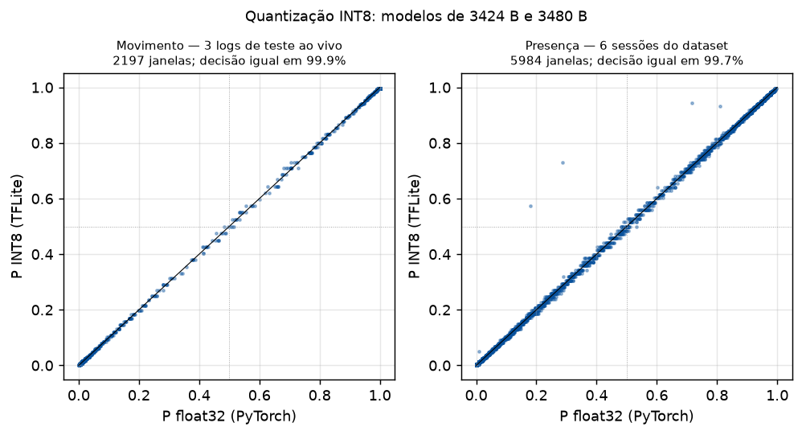

*Figura 6 — Probabilidade float32 × INT8 em dados de teste: os pontos ficam sobre a diagonal, em
"degraus" de 1/256 (resolução da saída int8).*

### 6.2 Custo na placa

| recurso | valor | como foi medido |
|---|---|---|
| inferência por modelo | **0,42 ms** (mediana; p10–p90: 0,40–0,43 ms) | campo `infer_us` de 2194 janelas gravadas no ESP32 a 240 MHz (MLP Core7 INT8, mesma arquitetura 7-16-8-1) |
| duas inferências por decisão | ~0,85 ms a cada 480 ms | **< 0,2 % de CPU** |
| RAM estática da aplicação | 39 KB (2 arenas TFLM de 8 KB, janela 50×51, buffers de calibração) | `idf.py size-components` |
| flash do TFLite Micro | 25 KB | idem |
| flash dos 2 modelos | 6,9 KB | `model_*_data.cpp` |
| firmware RX completo | 783 KiB (24 % livre na partição de 1 MB); DRAM 41 % | `idf.py size` |

Outras otimizações: apenas 2 operadores registrados (`MicroMutableOpResolver<2>`) e kernels SVDF
excluídos da compilação (ver 8.5).

---

## 7. Refinamento

### 7.1 Iterações do projeto

| quando | o que foi tentado | resultado | decisão |
|---|---|---|---|
| 11/11 | exemplo ESP-CSI [2] (HT40, 100 Hz), CSV bruto pela serial, MLP Keras de 13 features | pipeline funciona; a serial perde pacotes | fila FreeRTOS, 40 Hz |
| 12/11 | MLP treinada no **dataset público** de [1] (ESP32-S3) | 0,94 no teste deles; na nossa sala vazia, **100 % das janelas ao vivo viram movimento** | descartado: *domain shift* entre hardware e ambiente |
| 12–13/11 | 12 features calculadas no ESP32, MLP local | 0,95 no teste da própria campanha; nas gravações seguintes (inclusive após reiniciar TX/RX), 100 % das janelas viram movimento, com entradas deslocadas em até 100 desvios-padrão | é preciso **referência local** |
| 13/11 | referência da sala vazia (20 janelas) + log-razão | Core7: 0,98–1,00 por setup inteiro | estágio de movimento definido |
| 13/11 | paridade numérica PC × placa | bug: entrada int8 logada depois do `Invoke()` | cópia antes da inferência |
| 16/11 | 3 classes com features temporais | parado: 78 % na validação, **0/55** ao vivo | features temporais não veem pessoa parada |
| 18–19/11 | log `CSI_SIG` (assinatura espectral) | distância à referência separa pessoa parada | estágio de presença espectral |
| 21–22/11 | logística com 105 features (perfil inteiro) | boa dentro da geometria | risco de decorar a sala → 7 features resumidas |
| 23/11 | esta versão | dois estágios PyTorch → TFLite INT8, 3 estados | — |

### 7.2 Comparação de variantes do modelo de presença

`ml/02b_presence_refinement.py` reproduz, com a mesma validação por sessão, as variantes
comparadas antes de fixar o modelo:

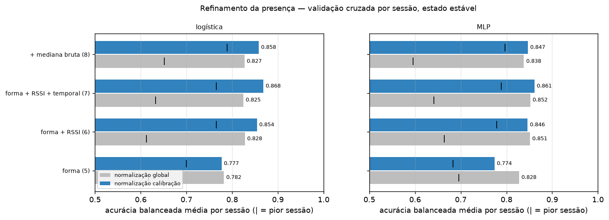

*Figura 7 — Acurácia balanceada média (barra) e pior sessão (|) por conjunto de features e tipo de
normalização (estado estável).*

| variante (MLP, estado estável) | média | pior sessão |
|---|---|---|
| só forma (5), normalização global | 0,828 | 0,696 |
| forma + RSSI (6), normalização global | 0,851 | 0,664 |
| forma + RSSI + temporal (7), normalização global | 0,852 | 0,641 |
| **forma + RSSI + temporal (7), normalização pela calibração** | **0,861** | **0,789** |
| + mediana bruta (8), normalização pela calibração | 0,847 | 0,797 |
| mesma (7), decisão por janela, **sem filtro temporal** | 0,846 | 0,778 |

**Leitura:**

* **Normalizar pelo ruído da calibração** quase não muda a média, mas sobe muito o **pior caso**
  (0,64 → 0,79). É isso que importa ao instalar o sensor numa sala nova.
* O **RSSI** soma ~0,07 com a normalização da calibração: a pessoa também atenua o enlace, não só deforma o perfil.
* A **feature temporal** acrescenta ~0,015 e a **mediana bruta** não ajuda: ela depende do ganho
  automático do rádio, por isso ficou de fora.
* O **filtro temporal** acrescenta ~0,015 e elimina piscadas isoladas do LED.
* Com a logística a ordem das variantes é a mesma, o que indica que a conclusão vem das
  features e não da rede.

---

## 8. Implantação na plataforma

### 8.1 Da rede PyTorch ao microcontrolador

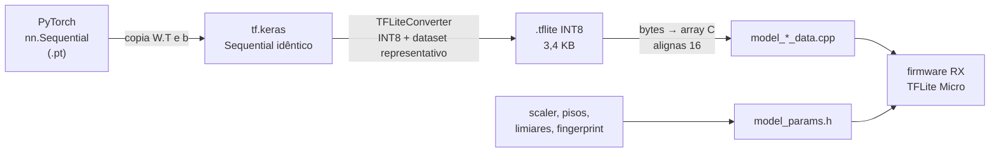

`ml/03_export_firmware.py`, para cada estágio:

1. **PyTorch [10] → Keras**: a MLP é recriada como `tf.keras.Sequential` (Dense+ReLU, Dense+ReLU,
   Dense+sigmoide) e os pesos são copiados (`W.T`, `b`); diferença máxima 1,2 × 10⁻⁷. Com uma MLP
   pequena a cópia direta é exata e dispensa o intermediário ONNX.
2. **Keras → TFLite INT8** [7] (fase 6) e verificação no PC executando o `.tflite` exatamente como o
   firmware faz.
3. **TFLite → C**: os bytes viram `src/rx/model_motion_data.cpp` e `model_presence_data.cpp`. As
   constantes de pré-processamento (médias, desvios, pisos, limiares) viram `src/rx/model_params.h`,
   com um **fingerprint** FNV-1a dos modelos.
4. **Vetores de teste** para os testes nativos C++ (`tests_native/vectors/`).

### 8.2 TinyML no firmware (TFLite Micro)

O TensorFlow Lite Micro [5] é um interpretador de modelos `.tflite` feito para microcontroladores:
não usa alocação dinâmica nem sistema operacional, e só compila os operadores registrados. No
ESP32 ele vem como componente ESP-IDF [4].


* Os `.tflite` ficam na **flash** como arrays `const`; nada é carregado em tempo de execução.
* `MicroMutableOpResolver<2>` registra só `FULLY_CONNECTED` e `LOGISTIC`.
* Cada modelo tem um `MicroInterpreter` próprio com uma **arena estática de 8 KB**: sem `malloc`;
  o uso real é logado no boot.
* No boot o firmware confere a forma e a quantização de cada tensor contra `model_params.h`. Se o
  `.tflite` e os headers vierem de exportações diferentes, ele recusa iniciar.
* A cada janela: pré-processamento em C++ (`csi_core7_calibrator.h`, `csi_presence.h`) →
  quantização da entrada → `Invoke()` → probabilidade → filtro (`csi_temporal_filter.h`) → fusão e
  LED (`csi_state_machine.h`).
* O fingerprint é gravado junto com a referência na NVS. Se um modelo mudar, a referência antiga
  é recusada e o LED pede nova calibração.

### 8.3 Arquivos do firmware

| arquivo | função |
|---|---|
| `src/rx/app_main.c` | Wi-Fi/ESP-NOW (canal 11, HT20, MCS0), habilita CSI |
| `src/rx/csi_stream.c` | fila entre o callback CSI e a tarefa de inferência; `CSI_STATS` a cada 10 s |
| `src/rx/csi_live.cpp` | pipeline completo: formato, LLTF, reamostragem, janelas, calibração, 2 modelos, fusão, LED, logs |
| `src/rx/firmware_config.h` | **modo do firmware** (DEPLOY / CAPTURE / VALIDATION) |
| `src/rx/csi_features.cpp` | 12 features temporais |
| `src/rx/csi_core7_calibrator.h` / `csi_presence.h` | referências e normalização dos dois estágios |
| `src/rx/csi_temporal_filter.h` / `csi_state_machine.h` | filtro, fusão em 3 estados, padrões do LED |
| `src/rx/csi_calibration_nvs.h` | registro NVS (referências + fingerprint + checksum) |
| `src/rx/model_*_data.cpp`, `model_params.h` | **gerados** por `ml/03_export_firmware.py` |
| `src/tx/app_main.c` | transmissor |

### 8.4 Uso da placa

| GPIO26 no boot | NVS | comportamento | LED |
|---|---|---|---|
| em 3V3 | qualquer | espera 12 s (saia da sala) → 20 janelas vazias (~10 s) → grava NVS → detecta | flash curto a cada 1,6 s; depois curto-curto-longo ×3 |
| aberto | referência válida | carrega e detecta imediatamente | 1 flash curto |
| aberto | ausente / de outro modelo | não classifica | 4 flashes rápidos repetidos |

Passo a passo: (1) ligue o TX; (2) com o RX desligado, feche o jumper; ligue e saia da área em
até 12 s; (3) espere o curto-curto-longo; (4) desligue, retire o jumper e ligue de novo (pode ser em
power bank); (5) sala vazia → apagado, parado → pisca, andando → aceso. **Recalibre sempre que TX/RX
ou a configuração da sala (porta, móveis) mudarem.** Sem pacotes do TX por 5 s, o LED apaga.

### 8.5 Compilar e gravar

```bash
pio run -e tx -t upload                 # TX (ESP32-C3, COM5)
pio run -e rx -t upload                 # RX demonstração (ou rx_capture / rx_validation)
pio device monitor -e rx                # 921600 baud
```

Na primeira compilação o PlatformIO baixa o ESP-IDF 5.5.3 e os componentes fixados em
`dependencies.lock`, e gera `sdkconfig.<env>` a partir dos `*.defaults`. O `CMakeLists.txt` da raiz
**exclui os kernels SVDF** do TFLite Micro (mensagem `kernels SVDF excluídos` no configure). Em
algumas instalações Windows o GCC falha neles com *internal compiler error*, e os modelos não os
usam. Se `svdf_common.cc` ainda aparecer, apague `.pio/build/<env>` e compile de novo. Se trocar os
modelos, rode `python ml/03_export_firmware.py` antes de compilar.

### 8.6 Validar o firmware na placa

1. Grave `rx_validation`, calibre (jumper) e capture com
   `python tools/capture_serial.py --port COM6 --out data/tests/firmware/validation_01.log`.
2. `python ml/06_verify_device_log.py data/tests/firmware/validation_01.log`

O script recalcula no PC, com a mesma referência que a placa usou (`CSI_REF`), as entradas int8
dos dois modelos e as compara com as da placa (`CSI_VEC`). Em seguida executa o `.tflite` no PC
sobre as entradas da placa, compara as saídas e refaz filtro e fusão contra `CSI_STATE`.
`--self-test` verifica a própria ferramenta com um log sintético.

---

## 9. Análise dos resultados

### 9.1 Movimento

**Tabela 9.1 — validação cruzada (estado estável).**

| setup fora do treino | M1 (referência) | M2 (RX reiniciado) | M3 (TX reiniciado) | M4 (nova sessão) | M5 (geometria alterada) | campanha M1–M3 | campanha M4–M5 |
|---|---|---|---|---|---|---|---|
| acurácia balanceada | 1,000 | 1,000 | 1,000 | 0,997 | 1,000 | 1,000 | 0,998 |
| parado marcado como movimento | 0 % | 0 % | 0 % | 0 % | 0 % | 0 % | 0 % |

**Tabela 9.2 — teste ao vivo** (fração das janelas seguras com estado MOVING).

| log | vazio | parado | andando | só braços | concordância com o modelo que estava na placa |
|---|---|---|---|---|---|
| live_A | 0 % / 1,5 % | 0 % | 100 % | 100 % | 99,7 % |
| live_B | 0 % | 0 % | 94 % | 29 % | 100 % |
| live_C | 0 % | 0 % | 100 % | 43 % | 100 % |

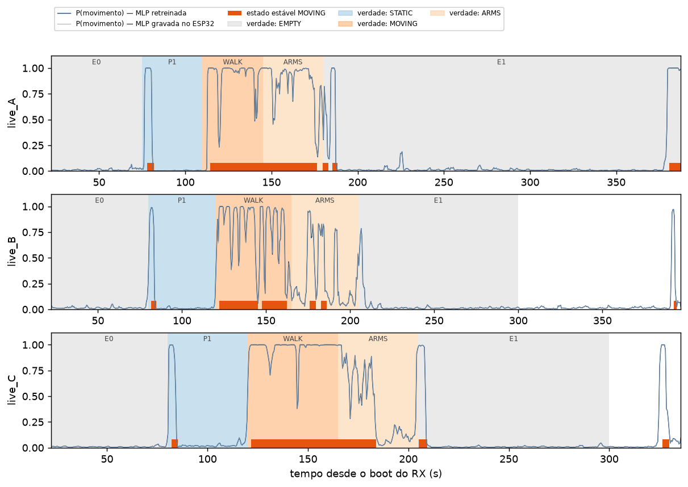

*Figura 8 — P(movimento) da MLP retreinada (azul) sobre a MLP que estava gravada no ESP32
(cinza, praticamente idêntica) e estado estável MOVING (laranja).*

**Discussão.** O resultado ao vivo confirma a validação cruzada: caminhada detectada em quase todas
as janelas e nenhum falso movimento com a pessoa parada. Mexer só os braços, parado no lugar, é
detectado parcialmente (29–100 %). Esse caso não estava no treino ("movimento" = caminhar) e gera
um sinal mais fraco; no sistema de 3 estados ele aparece como STATIC ou MOVING, e os dois contam
como presença. O pipeline atual reproduz o modelo que já estava na placa (mesmo scaler, mesma
quantização, decisões iguais em ≥ 99,7 % das janelas).

### 9.2 Presença

**Tabela 9.3 — validação cruzada por sessão (estado estável).**

| método | média (pior sessão) | recall | especificidade | fases com pessoa detectadas | fases vazias corretas |
|---|---|---|---|---|---|
| limiar 3× (sem treino) | 0,818 (0,694) | 0,949 | 0,653 | 21/21 | 20/27 |
| regressão logística | 0,868 (0,765) | 0,885 | 0,893 | 19/21 | 24/27 |
| **MLP (embarcada)** | **0,861 (0,789)** | **0,906** | **0,838** | **19/21** | **23/27** |

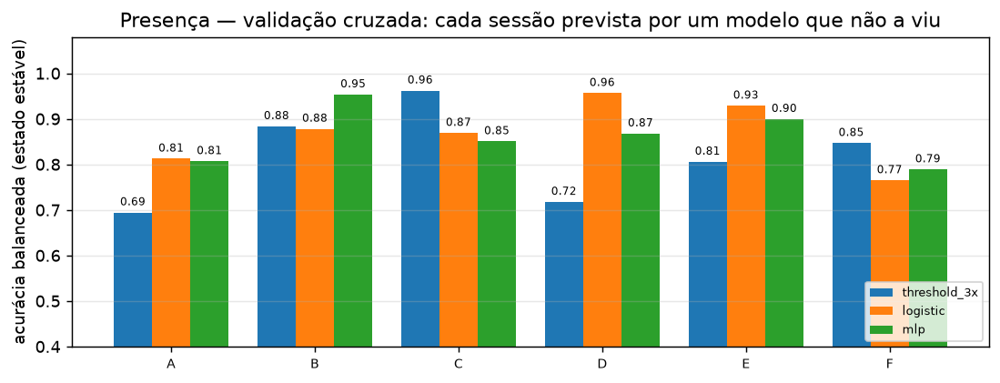

*Figura 9 — Acurácia balanceada por sessão; cada barra vem de um modelo que não viu aquela sessão.*

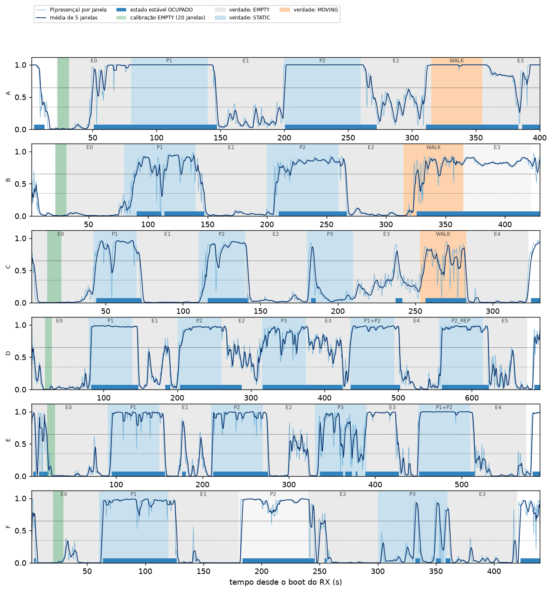

*Figura 10 — Cada sessão prevista por um modelo que não a viu. Fundo = verdade (cinza vazio, azul
parado, laranja andando); linha = P(presença); barra azul = estado ocupado; verde = calibração.*

**Discussão.**

* **Onde funciona:** pessoa parada dentro do quarto, na porta e **duas pessoas** são detectadas em
  praticamente 100 % do tempo (A P1/P2, C P1/P2, todas as posições de D, E P1/P2/P1+P2, F P1).
  A sessão B atinge 0,953.
* **Atrás da parede é o limite:** C P3 (atrás da parede) só é detectado no começo da fase (0 % das
  janelas seguras); F P3 também é fraco (19 %). A parede atenua o efeito sobre o perfil até o nível do ruído da sala vazia.
* **Os falsos positivos têm um padrão:** aparecem em trechos vazios que **não voltam à
  referência** — o começo de A (a análise original já indicava deriva na calibração dessa sessão)
  e os vazios logo depois de certas posições (fase E3 das sessões D e E, logo após P3). A explicação mais provável é
  o ambiente não ter voltado ao estado calibrado (porta, objeto deslocado) ou a pessoa ter ficado
  perto do enlace. O modelo mede **desvio em relação à sala calibrada**; ele não distingue "pessoa"
  de "a sala mudou".
* **ML × limiar:** o limiar fixo quase nunca perde uma pessoa (recall 0,95), mas dispara em 35 %
  do tempo vazio. Combinando forma, RSSI e estabilidade temporal, a rede troca um pouco de recall
  por muito mais especificidade (0,65 → 0,84).

### 9.3 Sistema completo de 3 estados

Replay de ponta a ponta nas 6 sessões. Presença: probabilidades fora-da-dobra. Movimento: o
estado que o detector Core7 da placa registrou durante a captura (linhas `CSI_FRAME`). Em A e F
esse detector marcava MOVING no próprio trecho vazio de calibração — a placa tinha carregado da
NVS uma referência de **outra geometria** —, então ali o estágio de movimento é descartado. O
firmware atual calibra os dois estágios juntos, o que elimina essa situação.

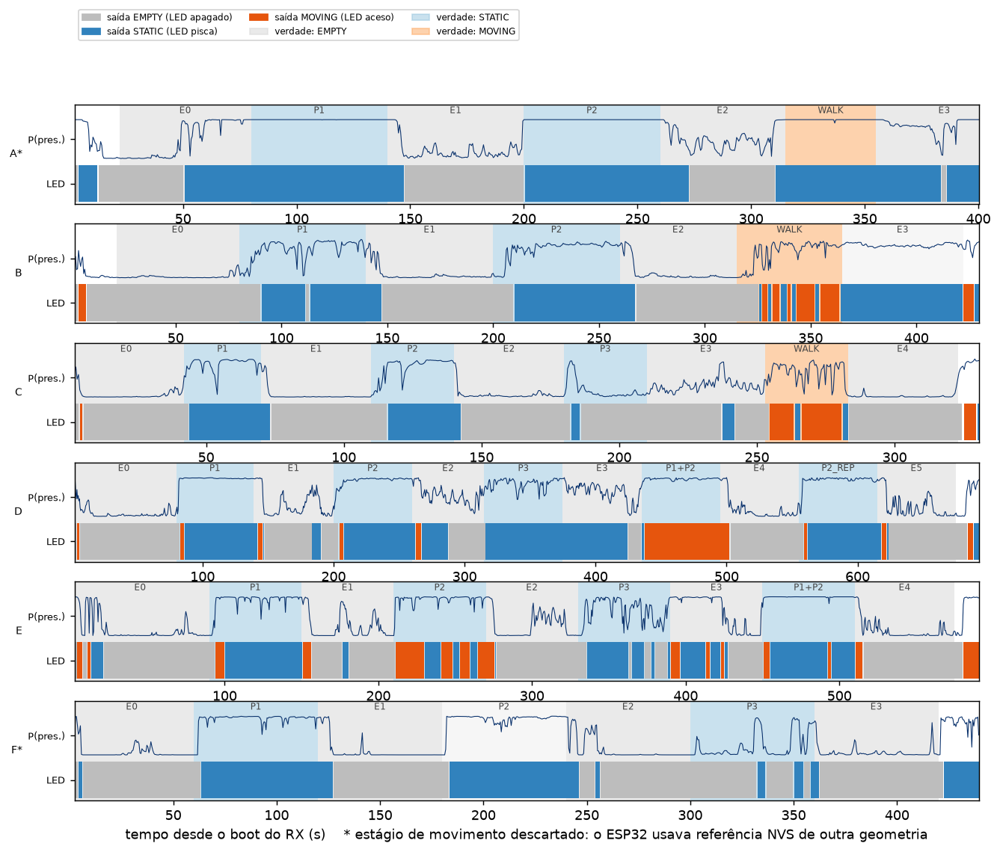

*Figura 11 — Saída final (faixa inferior: cor = LED; cinza apagado, azul piscando, laranja aceso)
sobre a verdade.*

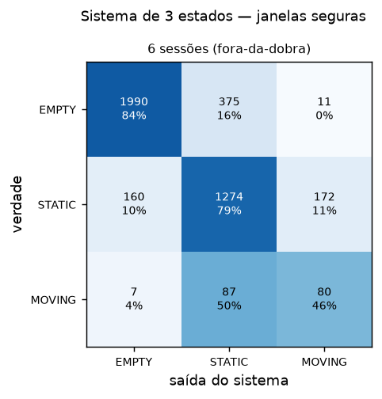

*Figura 12 — Matriz de confusão das janelas seguras.*

| leitura pelo objetivo (vazio × ocupado) | resultado |
|---|---|
| pessoa parada → ocupado (STATIC ou MOVING) | 1446 / 1606 = **90 %** |
| pessoa andando → ocupado | 167 / 174 = **96 %** |
| sala vazia → EMPTY | 1990 / 2376 = **84 %** |

A confusão entre STATIC e MOVING (ex.: duas pessoas paradas em D aparecem como MOVING) não
afeta o objetivo principal. Nestas sessões o estágio de movimento não mudou as métricas de
presença, porque a assinatura espectral já detecta quem está andando. Ele acrescenta a
informação "em movimento", útil para a aplicação, e cobre o caso de alguém passando rápido.

### 9.4 Cadeia de equivalência (PC × placa)

| verificação | resultado |
|---|---|
| PyTorch × Keras (float) | máx. \|Δp\| = 1,2 × 10⁻⁷ |
| INT8 × float | mesma decisão em ≥ 99,6 % das janelas; estado estável igual em ≥ 99,7 % |
| TFLite (PC) × TFLite Micro (ESP32), 2197 janelas ao vivo¹ | 2196 saídas int8 idênticas, máx. 1 LSB (0,004) |
| pré-processamento C++ do firmware × Python² | 0 / 2100 entradas int8 diferentes (presença), 0 / 1400 (movimento) |
| compilação ESP-IDF 5.5.3 (framework do `espressif32@6.13.0`) | TX e RX (nos 3 modos), sem warnings no código do projeto |

¹ com o modelo de movimento que estava gravado na placa (`models/legacy/`) e as entradas/saídas int8
que ela registrou. ² `tests_native/` compila os headers do firmware no PC e os alimenta com vetores
exportados pelo Python.

### 9.5 Limitações e ameaças à validade

* **Escala do experimento:** 6 sessões de presença em poucos dias, numa mesma residência, com
  poucas pessoas. Janelas sobrepostas não são amostras independentes. Os números indicam ordem de
  grandeza, não desempenho de produto.
* **O firmware de 3 estados não foi executado na placa neste trabalho.** Cada parte foi verificada
  separadamente (C++ × Python bit a bit, TFLite × TFLite Micro com o modelo anterior, compilação dos
  3 modos). O próximo passo é gravar `rx_validation`, capturar uma sessão nova e rodar
  `ml/06_verify_device_log.py`; essa sessão nova, intocada, também serviria de teste final.
* **Dependência da referência:** mudanças permanentes na sala aparecem como presença. Uma
  referência adaptativa (atualizar lentamente durante longos períodos vazios confiáveis) é o
  próximo passo natural, mas exige gravações de horas para ser validada.
* **Rótulos por cronômetro:** incerteza de alguns segundos nas fronteiras, mitigada pelas margens.
* **Calibração com a sala realmente vazia:** quem estiver presente na calibração vira "vazio".

### 9.6 Potencial para ambientes maiores

Um único par TX–RX detectou pessoas paradas fora da linha de visada direta (porta, segunda pessoa)
e, de forma fraca, atrás de parede — situações em que um PIR não detecta nada (pessoa parada) ou
precisaria de mais unidades (obstáculo). O ESP-CSI [2] prevê **um transmissor e vários receptores**
recebendo o mesmo broadcast, e [1] já usou dois receptores simultâneos; cada RX custa poucos dólares e roda a inferência localmente em < 1 ms.
Escalar para salas maiores significa acrescentar receptores (mais enlaces cruzando o ambiente) e
fundir suas decisões, sem câmeras e sem enviar dados brutos para fora do dispositivo.

---

## 10. Relatório e reprodução

### 10.1 Reproduzir todos os resultados (PC)

```bash
python -m venv .venv
# Windows: .venv\Scripts\activate      Linux/macOS: source .venv/bin/activate
pip install -r ml/requirements.txt
python ml/run_all.py            # ~1,5 min em CPU
```

| etapa | script | fase | gera |
|---|---|---|---|
| 0 | `python -m unittest discover -s ml/tests` | — | testes do pacote `ml/csi` |
| 1 | `python ml/01_train_motion.py` | 5, 9 | `models/motion/`, `results/motion_*`, Figuras 3, 4, 8 |
| 2 | `python ml/02_train_presence.py` | 5, 9 | `models/presence/`, `results/presence_*`, Figuras 1, 2, 5, 9, 10 |
| 3 | `python ml/02b_presence_refinement.py` | 7 | `results/presence_refinement*.csv`, Figura 7 |
| 4 | `python ml/03_export_firmware.py` | 6, 8 | `models/*/*.tflite`, `src/rx/model_*`, `results/export_report.json`, Figura 6 |
| 5 | `python ml/04_replay_3state.py` | 9 | `results/replay_3state.*`, Figuras 11, 12 |
| 6 | `python ml/06_verify_device_log.py --self-test` | 8 | autoteste da validação na placa |
| 7 | `bash tests_native/run.sh` | 8 | paridade C++ × Python |

O treino é determinístico: rodar de novo regenera os mesmos `.tflite`, headers e métricas.

### 10.2 Analisar uma captura nova

```bash
python ml/05_analyze_log.py data/dataset/presence/G.log --cal-start 20       # figura da sessão
python ml/06_verify_device_log.py data/tests/firmware/validation_01.log      # se gravada em rx_validation
```

Para incorporar ao dataset: acrescente a sessão ao `data/manifest.json` (`"role": "dataset"`
para treinar, `"holdout"` para teste final) e rode `python ml/run_all.py`.

### 10.3 Estrutura do repositório

```text
.
├── README.md                    este documento (relatório)
├── platformio.ini               envs tx, rx (demonstração), rx_capture, rx_validation
├── CMakeLists.txt               projeto ESP-IDF (+ exclusão dos kernels SVDF)
├── sdkconfig.{rx,tx}.defaults   CSI habilitado, 921600 baud, buffers Wi-Fi
├── dependencies.lock            versões fixas dos componentes ESP-IDF
├── src/tx/                      transmissor ESP-NOW
├── src/rx/                      receptor: CSI, features, 2 modelos TFLM, LED, NVS, modos
├── ml/
│   ├── csi/                     pacote: logs, rótulos, features, redes, filtro, métricas, export, figuras
│   ├── 01_train_motion.py       treino + validação do movimento
│   ├── 02_train_presence.py     treino + validação da presença
│   ├── 02b_presence_refinement.py  variantes (fase 7)
│   ├── 03_export_firmware.py    otimização, TFLite INT8, headers C
│   ├── 04_replay_3state.py      sistema completo nos logs
│   ├── 05_analyze_log.py        analisar uma captura nova
│   ├── 06_verify_device_log.py  validar o firmware na placa
│   ├── run_all.py               tudo, em ordem
│   └── tests/                   testes unitários
├── tests_native/                testes C++ dos headers do firmware × vetores do Python
├── tools/capture_serial.py      captura serial com marcação de fases
├── data/dataset/                dados de treino (presença e movimento)
├── data/tests/                  logs de teste ao vivo (nunca treinados)
├── data/manifest.json           rótulos
├── models/                      .pt, .tflite, preprocessing.json (+ legacy/ para a paridade PC × placa)
├── results/                     métricas (CSV/JSON)
└── docs/figures/                figuras deste README
```

---

## Referências

**Projeto de referência**

1. T. M. Fahim, A. U. Zaman, M. A. H. Nayeem e R. H. Bapon. *Privacy-Preserving Human Presence and
   Motion Detection Using Wi-Fi CSI*. Projeto final de EEE 416, Bangladesh University of Engineering
   and Technology (BUET), 2026. https://github.com/Tahmid-Mahmud-Fahim/esp32-based-presence-and-motion-detection-using-wifi-csi
   — o que foi usado e o que foi só inspiração está na [seção 1.5](#15-projeto-de-referência-o-que-foi-usado-e-o-que-foi-só-inspiração).

**Plataforma e documentação Espressif**

2. Espressif Systems. *ESP-CSI* — exemplos `csi_send`/`csi_recv`, métodos de obtenção de CSI e
   recomendações de montagem. https://github.com/espressif/esp-csi
3. Espressif Systems. *ESP-IDF Programming Guide (ESP32) — Wi-Fi Driver: Wi-Fi Channel State
   Information*. https://docs.espressif.com/projects/esp-idf/en/latest/esp32/api-guides/wifi.html#wi-fi-channel-state-information
4. Espressif Systems. *esp-tflite-micro* (componente TensorFlow Lite Micro para ESP-IDF).
   https://components.espressif.com/components/espressif/esp-tflite-micro

**TinyML e quantização**

5. R. David, J. Duke, A. Jain, V. Janapa Reddi, N. Jeffries, J. Li, N. Kreeger, I. Nappier,
   M. Natraj, T. Wang, P. Warden e R. Rhodes. "TensorFlow Lite Micro: Embedded Machine Learning for
   TinyML Systems". *Proceedings of Machine Learning and Systems 3 (MLSys)*, 2021. arXiv:2010.08678.
6. B. Jacob, S. Kligys, B. Chen, M. Zhu, M. Tang, A. Howard, H. Adam e D. Kalenichenko.
   "Quantization and Training of Neural Networks for Efficient Integer-Arithmetic-Only Inference".
   *IEEE/CVF CVPR*, 2018, pp. 2704–2713. doi:10.1109/CVPR.2018.00286
7. TensorFlow. *Post-training integer quantization* (documentação do TFLite Converter).
   https://www.tensorflow.org/lite/performance/post_training_integer_quant

**Wi-Fi sensing com CSI**

8. Y. Ma, G. Zhou e S. Wang. "WiFi Sensing with Channel State Information: A Survey".
   *ACM Computing Surveys*, v. 52, n. 3, 2019. doi:10.1145/3310194
9. D. Halperin, W. Hu, A. Sheth e D. Wetherall. "Tool Release: Gathering 802.11n Traces with Channel
   State Information". *ACM SIGCOMM Computer Communication Review*, v. 41, n. 1, p. 53, 2011.
   doi:10.1145/1925861.1925870

**Ferramentas de software**

10. A. Paszke et al. "PyTorch: An Imperative Style, High-Performance Deep Learning Library".
    *Advances in Neural Information Processing Systems 32 (NeurIPS)*, 2019.
11. F. Pedregosa et al. "Scikit-learn: Machine Learning in Python". *Journal of Machine Learning
    Research*, v. 12, pp. 2825–2830, 2011.
12. PlatformIO. *Espressif 32 development platform* (`espressif32@6.13.0`).
    https://github.com/platformio/platform-espressif32
